# Progress

| Milestone | Scope | Status |
|---|---|---|
| 1 | Scaffold, Makefile, 32 MB arena (`mem.c`), VFPU math (`vfpu.c`), `tex_demaker.py`, `mesh_demaker.py` | Done |
| 2 | `world_demaker.py` (17×17 terrain, batched cells) + `zone.c` + fogged `sceGu` renderer (`gfx.c`) | Done |
| 3 | `phys.c` collision, controls, doors/zone transitions, segmented-limb animation | Done |
| 4 | `rpg_compiler.py`, MWScript VM (`vm.c`), dialogue + journal UI (`ui.c`) | Done |
| 5 | Combat, magic, inventory/barter/loot UI, character creation, levelling (`rpg.c`) | **Done – awaiting review** |
| 6 | AI (`ai.c`), audio mixer (`audio.c`), save/load (`save.c`), 30/60 FPS pass | Not started |

## Milestone 5 — delivered

All formulas follow OpenMW's implementation of the original rules, read
from GMSTs in the load order with Morrowind's shipped values as fallbacks.

### Cooker
* `mwdata.py` — the engine constants that are not in the ESM: all 143 magic
  effects with their hard-coded flags (generated from OpenMW's table),
  resisted-by / weakened-by pairs, the 27 skills (GMST names, governing
  attribute, specialisation, default use gains), school → skill, marker ids.
* `rpg_compiler.py` writes **DRPG v2**: skill, magic-effect, race, travel
  and marker tables, birthsign objects, class services merged into NPC
  services, NPC travel destinations, interior Divine/Almsivi markers, and
  autocalculated NPC stats (level-scaled attributes, skills, health,
  magicka, fatigue from race + class + specialisation). See
  `docs/FORMATS.md`.
* `gen_mwfuncs.py` also emits `MGEF_*`, `SKILL_*`, `ATTR_*` enums and the
  extra stat properties (skill progress, level progress, attribute
  multipliers, damage, dead, book read…).

### Runtime
* `rpg.c` — the mechanics layer, installed as the VM's stat hook so scripts
  and dialogue filters see modified values:
  * stats: attributes/skills with Fortify/Drain/Damage/Absorb, health,
    magicka (Fortify Maximum Magicka), fatigue, encumbrance and capacity
    (Burden/Feather), armour rating, walk/run/swim/jump speeds, fatigue
    term, disposition (race, faction reactions, personality, Charm…).
  * progression: skill use with per-use gains, major/minor/misc and
    specialisation multipliers, skill raises, level progress, attribute
    multipliers (`iLevelUpXXMult`), "rest and meditate", level-up with
    Endurance-based health gain, skill books.
  * magic: an active-effect pool with durations, one-shot and per-second
    application, magnitude rolls, resistances/weaknesses, reflect,
    absorb, spell absorption, Dispel, Cure *, Mark/Recall, Divine and
    Almsivi Intervention (to the cooked markers), Open/Lock, Levitate /
    Water Walking / Jump / Slowfall (fed to `phys.c`), Paralyze, bound
    weapons and armour (re-equipping what they displaced), soul trap into
    the smallest fitting empty gem, diseases and curses. Abilities,
    diseases and constant-effect items are rebuilt as constant effects.
  * death, natural fatigue regeneration, rest and wait (health and magicka
    recovery per hour, effects run their course), character creation
    (race + sex, class, birthsign: attributes, skills, powers, abilities,
    starting spells chosen like Morrowind's autocalc), visited cells.
* `rpg_items.c` — item stacks with condition / charge / soul (stacks split
  when one item changes), 19 equipment slots with two-handed, shield and
  beast-race rules, auto-equip for NPCs, item value by condition and
  charge, potions, ingredients (first effect), scrolls, enchanted items
  (cast on use, on strike, constant), spell cost and success chance with
  the fatigue term, casting, melee / ranged / hand-to-hand attacks (hit
  chance, strength and condition damage scaling, critical sneak attacks,
  armour reduction and wear, blocking, weapon wear, ammunition), lock
  picking with the Security formula.
* `rpg_trade.c` — services by record flags, merchant item types, barter
  prices (disposition, mercantile, personality, luck, fatigue), merchant gold
  with a daily restock, buying and selling, training (price, skill caps,
  two game hours), spell merchants, repair prices and self repair with
  hammers/prongs, travel prices and teleport, persuasion (admire,
  intimidate, taunt, bribes: temporary and permanent disposition changes),
  alchemy (apparatus quality, effect visibility by skill, potion strength,
  value, player-made potions), spellmaking (cost and price, named custom
  spells), enchanting (points vs. capacity, soul charge, constant effects
  costed with `fEnchantmentConstantDurationMult`, self-enchant chance,
  custom enchanted items).
* `game.c` — combat controls (ready weapon / magic, wind-up and strike,
  bows consume ammunition, a readied lockpick picks the targeted lock,
  casting at touch range or along the aim ray with area effects), hostile
  actors close in and strike (stand-in until the M6 AI), death animation and
  lootable corpses, containers open the loot screen, hostile NPCs refuse to
  talk, jumping and fall damage (Acrobatics), encumbrance, `rpg_tick`,
  respawn, and the script verbs for the character-creation menus,
  EnableRest/ShowRestMenu, GetWeaponDrawn/GetSpellReadied, Lock/Unlock.
* `dialogue.c` — Persuasion-type topics (`Admire Success`, `Bribe Fail`…)
  answer the persuasion menu; `Service Refusal` (disposition test inverted)
  can refuse services.
* UI (`ui.c` core, `ui_menu.c`, `ui_trade.c`, `ui_char.c`), all on the 8×8
  console font:
  * dialogue lists the NPC's services before the topics.
  * SELECT menu with five tabs (Stats, Inventory, Magic, Map, Journal);
    tabs follow the character-creation scripts' `Enable*Menu` calls.
  * loot (take, put, take all), barter (two columns with prices, one or a
    stack), persuasion, spells, training, repair, travel, alchemy,
    self-repair, spellmaking and enchanting with a shared effect editor and
    an on-screen keyboard for names.
  * character creation (name, race + sex, class, birthsign, review with
    jump-back), level up (three attributes with their multipliers), rest /
    wait (hours, until healed), death screen.
  * HUD drawn by the UI instead of the debug screen: health / magicka /
    fatigue bars, readied weapon or spell, wind-up bar, last enemy's health,
    crosshair, target name, messages, sneaking and level-up hints.

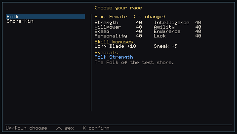
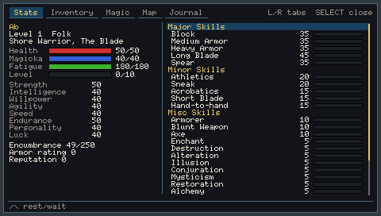
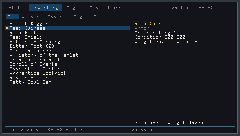
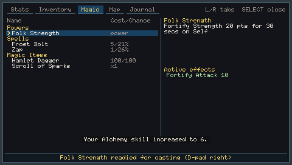
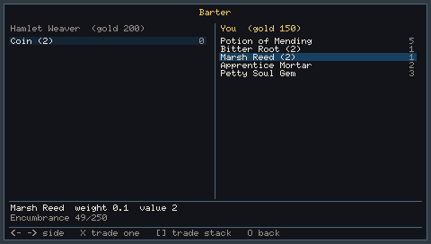
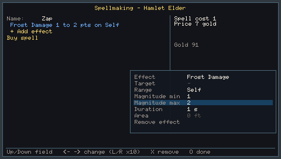
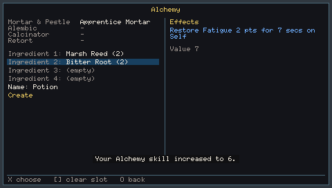
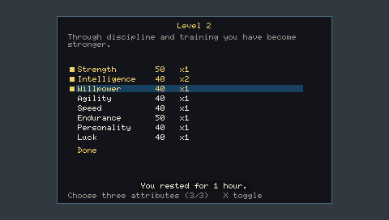

### Test world additions
Rules records (27 SKIL, 29 MGEF), two playable races (one beast) with
powers, two playable classes (the NPCs' own classes are not playable), two
birthsigns, abilities, a power, a disease, healing / frost / trap spells,
a sword, a bound dagger, armour and boots, a shield, potions,
ingredients, a mortar, a hammer, a lockpick, a soul gem, a scroll and a
skill book, a crate with gold, a critter carrying a root, an elder who
sells spells, trains, repairs, makes spells, enchants and travels, a weaver
who barters, Persuasion-type answers and a Service Refusal, and a Divine
Intervention marker.

### Verification run
* `make` → `EBOOT.PBP` (644 KB), zero warnings under `-Werror` (psp-gcc 15
  also caught an off-by-one in the keyboard table that host gcc missed).
  Static image 35.0 MB including the 32 MB arena.
* `make test`: 102 host checks; **128 cooker tests** (adds the v2 tables:
  skills, magic effects, races and powers, birthsigns, playable classes,
  travel, markers, NPC autocalc); world test; game test 40/40; rpg test
  73/73; **mech test 111/111** on the cooked database — chargen numbers
  (attributes, skills, derived maxima, powers), skill gains and
  multipliers, level-up, armour rating, beast-race boots, combat to death
  with weapon wear, creature bites, frost damage over time, a power once
  per day, potion, scroll, bound dagger expiry, disease and cure, alchemy,
  barter, training, spell purchase, repair, persuasion, travel, soul trap,
  enchanting, spellmaking, Mark/Recall/Divine Intervention, Open, lock
  picking, rest and a skill book; **ui test 167/167** — after the M4 quest
  it plays character creation, barter (sell and buy back), persuasion with
  the NPC's answer, buying a spell, making one, travel, equipping,
  reading a skill book, alchemy from the inventory, the magic and map tabs,
  looting a crate, killing the critter with the dagger and looting its
  corpse, resting into a level-up, and death and respawn, all with button
  presses through `game.c` + `ui.c` like `main.c`, with 22 new screenshots.

### Deferred to their milestones (by design, not stubs)
* Summoned creatures print a notice instead of appearing; full combat AI,
  fleeing, guards, crime, stealing/ownership and resting interrupted by
  wandering creatures arrive with the AI milestone (hostile actors use a
  simple approach-and-strike loop until then).
* Death restarts at the zone's entrance with full health: saved games are
  Milestone 6. Combat and spell sounds come with the audio mixer.
* Arrows and spells resolve along the aim ray at once (no visible
  projectile flight).

### Still not verified
1. Nothing has run on a PSP or in PPSSPP (building an emulator here was
   blocked in M4). The new screens are verified through the host
   rasteriser only.
2. Retail data: the formulas match OpenMW's, but Morrowind's real classes,
   races, 1 000+ spells and merchants have not been cooked here.

## Milestone 4 — delivered

### Cooker
* `mwsig.py` — all 511 MWScript verbs with their signatures (argument
  letters `f l s c S x X z j /`, return type, explicit-reference support),
  including the generated attribute/skill/dynamic/magic-effect/control
  families. `gen_mwfuncs.py` writes the matching C enum, signature table and
  stat-family table (`src/mwfuncs.h`); a test fails if it is stale.
* `mwscript.py` — MWScript compiler to a compact typed stack bytecode
  (`MWBC_*`, 48 opcodes). Reproduces the original grammar's quirks: `,`/`:`
  as whitespace, `[ ]` = `( )`, names with `-`/`'`/leading digits, greedy
  comparison-operator scanning (`=` and `= =` mean `==`), unparenthesised
  arguments ending at `+ - ==…` but not at `* /`, unary minus binding
  tightest, locals shadowing functions, unknown names parsed as numbers,
  MessageBox arguments typed from the format string, optional/ignored
  arguments, `ref->Func`, `ref.var` (object or global-script members),
  declarations anywhere. Errors skip the line with a warning; a broken
  `if` condition compiles to false and missing `endif`/`endwhile` are
  closed, so one bad line never loses a whole script. Dialogue result
  scripts compile in dynamic mode (speaker locals resolved by name at run
  time). Includes a disassembler.
* `rpg_compiler.py` → `rpg.dpak`:
  * `rpg/core` (resident): objects of 23 record types with type-specific
    stats (NPC/creature stat blocks, inventories, spell lists, weapon damage,
    armour, books, potions/ingredient effects, leveled lists, containers,
    lights, classes, races, regions), spells + enchantments with effects,
    factions (rank names, requirements, reactions), globals, all GMSTs,
    scripts + local variable tables, start scripts, topics (alphabetical +
    hash index), INFOs and conditions, text block directory, name pool.
  * `text/<n>`: ~32 KB raw-DEFLATE blocks of INFO and book text plus the
    compiled result scripts, read and inflated on demand.
  * `script/<id>`: bytecode + string pool, paged in on first run.
  * INFO lists merge across the load order with OpenMW's PNAM/NNAM rules
    (replace in place, move, insert after prev / before next, delete).
  * SCVR rules decode to typed conditions; header filters (actor, race,
    class, faction + rank, factionless "FFFF", rank, gender, PC faction/rank,
    cell prefix) become conditions tested first.
  * Book HTML is converted to plain text; Windows-1252 punctuation is
    transliterated for the 8×8 font; explicit `@topic#` links are flattened.
  * Writes `rpg_report.json` (counts, script errors, warning totals, text
    raw/packed sizes). `cook_all.py` runs it after the world step.

### Runtime
* `inflate.c` — allocation-free raw DEFLATE decoder (stored/fixed/dynamic).
* `rpgdb.c` — validates the core once (sorted tables, bounds of every
  index), binary-searched lookups, LRU cache of 4 inflated text blocks,
  384 KB bump cache for script bytecode (flushed wholesale when full).
* `vm.c` — interpreter (typed stack, 200 000-instruction budget per run,
  every operand bounds checked) and the scripted game state:
  * globals (with game time: GameHour/Day/Month/Year/DaysPassed advance with
    TimeScale), script instances whose locals persist across zone loads
    (keyed by object id for unique references, zone + refnum otherwise; a
    member access before a reference was ever loaded creates the instance
    lazily and the placed reference adopts it), global/targeted scripts,
    StartScript/StopScript/ScriptRunning, start scripts.
  * per-reference stat store (attributes, skills, health/magicka/fatigue
    base + current, magic-effect values, AI hello/fight/flee/alarm,
    disposition, reputation, level, crime, rank, deaths, enable state)
    seeded from the record — the whole Get/Set/Mod verb families work.
  * inventories and spell lists (AddItem/RemoveItem/GetItemCount,
    AddSpell/RemoveSpell/GetSpell), seeded from the record lists.
  * journal (entries dated, quest index, finished/restart flags,
    "journal updated" notice), known topics, heard infos, player faction
    ranks/reputation/expulsion, faction reactions.
  * MessageBox with buttons + GetButtonPressed, Choice, Goodbye,
    ForceGreeting, OnActivate/OnDeath/OnKnockout/OnMurder one-frame events,
    text defines (`%PCName %PCRace %PCClass %PCRank %NextPCRank
    %PCCrimeLevel %Name %Race %Class %Faction %Rank %Cell` + globals).
  * World verbs go to the host (`game.c`): Activate, GetDistance,
    Get/SetPos, Get/SetAngle, Position, PositionCell (player), CellChanged,
    GetInterior, GetPCRunning/Sneaking/Jumping, player controls,
    PlayGroup/LoopGroup on actors, Enable/Disable (hides the instance for
    rendering, collision and targeting; persists per reference).
* `dialogue.c` — OpenMW's filter order: greetings (Greeting topics in name
  order, no refusal fallback), topic answers with Info Refusal when only the
  disposition fails, creatures only answer infos with their id, all 74 SCVR
  functions plus Global/Local/Journal/Item/Dead/Not* kinds with
  Integer/Numeric/Boolean/Inverted semantics, Choice re-runs the last topic,
  Goodbye, topic learning from responses (longest keyword at a word start,
  only when the speaker can answer), heard/exhausted topics.
* `ui.c` + `ui_gu.c` — 8×8 MSX font (from PSPSDK) on a 6 px advance
  (80×30 characters), drawn as GE sprites from a 128×128 T4 texture in one
  draw call per text run. Dialogue window (history with hyperlinks, topic
  list + Goodbye, link focus, choices, scrolling, disposition), journal menu
  on SELECT with Journal / Quests / Topics tabs, book reader with "take",
  modal message boxes, toasts for notices. A host backend rasterises the
  same command list for tests and screenshots.
* `game.c` — scripted activation (OnActivate scripts decide, `Activate`
  performs the default), talking to NPCs/creatures, item pickup into the
  inventory, books, names in the target prompt, menu mode pauses the world
  while scripts keep running. SELECT now opens the journal; fly mode moved
  to the pause menu.

### Test world additions
"The Weaver's Lost Ring": two greetings, a rumor topic that seeds the quest
topic, a Choice, an Info Refusal gated by disposition, journal stages 10/20/
100 (finished), an OnActivate ring script with a MessageBox, a start script
with a button, a speaker-local result script, ModDisposition, AddItem/
RemoveItem, a faction with ranks, classes, a book, a weapon, a spell and an
enchantment, GMSTs and globals, and a deliberately broken script.

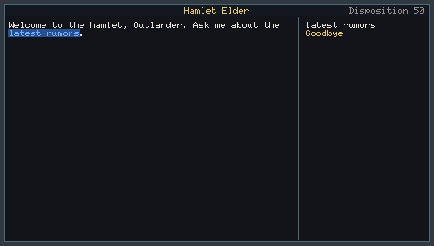
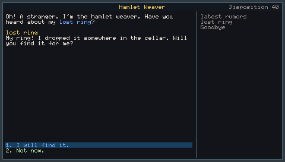
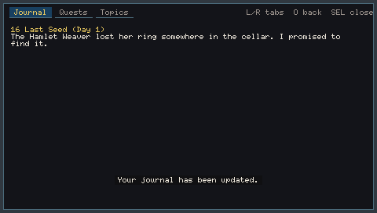
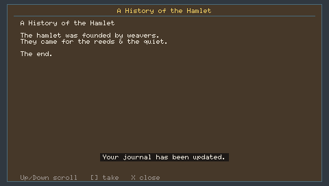

### Verification run
* `make` → `EBOOT.PBP` (454 KB), zero warnings under `-Werror`.
* `make test`: 102 host checks; **121 cooker tests** (adds 27 compiler
  tests for the scanner/precedence/argument-mode/member/MessageBox/error
  recovery rules, INFO merge order, SCVR decoding, book HTML, blob store,
  the full cook of the test world, load-order merging, the generated-header
  freshness check and the extended C/Python layout + opcode contract);
  world test; game test 40/40; **rpg test 73/73** — inflate vectors,
  database contents, the start-script message box and button, the whole
  quest through `dialogue.c` + `vm.c` (greetings, `%` defines, link spans,
  learning rules, Info Refusal, Choice, locked topics while choosing,
  journal stages and dates, OnActivate event lasting one frame, reward
  script on the speaker's locals, disposition-gated topic), the Goodbye
  branch, game time, then 4 000 fuzzed bytecode programs under ASan/UBSan;
  **ui test 58/58** — the same quest played with button presses through
  `game.c` + `ui.c` exactly like `main.c` (walk up, R to talk, follow a
  hyperlink, answer a choice, journal tabs, enter the cellar, read and take
  a book, pick up the scripted ring, claim the reward, the ring stays gone
  after reloading the cellar), no script errors, no unhandled verbs.

### Deferred to their milestones (by design, not stubs)
* Verbs for systems that do not exist yet run through the host and return
  the neutral value when nothing handles them (counted in `vm->unhandled`):
  AI packages (M6, `GetAIPackageDone` stays 0), sound/music/voice (M6;
  `Say` shows its subtitle, `SayDone` is 1), combat/crime/jail, equipment
  and soul gems (M5), spawning (`PlaceAtPC`…), locks. Dialogue functions
  that depend on them read the true current state (no weather, no combat
  targets, nothing equipped).
* Persuasion and services (barter, training, travel, spells) arrive with
  the M5 menus; the inventory/stats/magic tabs join the SELECT menu then.
* The journal topic list does not refine "exhausted" topics by the links in
  their answers (OpenMW does); heard answers are simply greyed.

### Still not verified
1. Nothing has run on a PSP or in PPSSPP. The UI's GE path (`ui_gu.c`:
   T4 font texture + CLUT, 2D sprites, state hand-back to `gfx.c`) is only
   compiled; the layout itself is verified by the host rasteriser.
2. Retail data untested: the compiler and dialogue filter follow OpenMW's
   rules, but the real 3 000+ scripts and ~30 000 infos have not been
   compiled here. `rpg_report.json` lists every script error, and
   `rpg/core` falls back to the script region if the DB region is full.

## Milestone 3 — delivered

### Cooker
* `anim_demaker.py` — `.kf` → DANIM: text keys → named groups (Start/Stop/
  Loop Start/Loop Stop, CR LF separated), controllers paired with the
  `NiStringExtraData` bone names (OpenMW `loadKf` order), resampled at
  15 fps (quaternion slerp; XYZ euler keys composed x→y→z as in OpenMW
  `getXYZRotation`), constant tracks stored once, int16 quaternions.
  `Bip01` horizontal root motion is stripped and stored as group speed.
* `mesh_demaker.py` keeps whole Biped hierarchies (`Bip01*` nodes), so bare
  skeletons such as `base_anim.nif` survive cooking.
* `world_demaker.py` assembles actors: NPC skeleton (`base_anim`,
  `base_anim_female`, `base_animkna` for beast races), race skin BODY parts
  by sex (female → male fallback), head/hair from the NPC record, rigid parts
  attached to MW attachment bones ("Head", "Right Hand", …; left side
  mirrored), skinned parts bound by bone name; creatures use the
  `x`-prefixed model + `.kf` (OpenMW `correctActorModelPath`). DZONE v2 adds
  actor and animation tables.
* `actorpose.py` — Python reference of the runtime posing; the preview tool
  now renders posed actors (`--group walkforward --time 0.25`).
* `make_testworld.py` — adds an original Biped skeleton, a race with
  skinned + rigid body parts, Idle/WalkForward clips, two villagers and a
  creature.

### Runtime
* `anim.c` — validated DANIM, binary-searched groups, looping playback,
  nlerp sampling.
* `actor.c` — bone↔track, part-node↔bone and part↔attachment bindings at
  zone load; per-frame posing of actors within 3000 units (one VFPU
  `mat4_mul` per bone); limb matrix = actor × bone × [mirror] × dequant.
* `phys.c` — static collision from every instance's DMESH collision
  (merged statics included) in a 256-unit CSR grid; swinging doors as
  dynamic triangles; terrain triangles built on demand from the 17×17
  patches; actors as cylinder obstacles. Movement: vertical cylinder vs
  triangle (clip to the slab [feet + 34, head], push out of the 2D
  footprint) so steps ≤ 34 units and slopes ≤ ~46° are walkable; gravity
  627.2, jump, step-down snap 62, ceilings, swimming with buoyancy,
  steep-slope sliding (OpenMW constants). Rays for activation.
* `game.c` — portable gameplay layer: two PSP control schemes (stick moves
  + face buttons look, or the reverse), run/walk, sneak, jump, debug fly,
  activation ray (192 units, occlusion-checked), teleport doors (lock
  check, destination zone + position), swinging doors, exterior border
  transitions, NPCs turning to face the player, debug animation cycling.
* `gfx.c` draws actors (mirrored limbs with flipped winding).
* `main.c` — pause menu (control scheme, invert look, face culling,
  overlay, quit), HUD (crosshair, activation prompt with door destination,
  messages), loading cards on zone requests.

### Verification run
* `make` → `EBOOT.PBP` (335 KB), zero warnings under `-Werror`.
* `make test`: 102 host checks; 72 cooker tests (adds KF parsing,
  resampling, XYZ-euler order, looping, root-motion stripping, NPC/creature
  assembly, posed NPC stands with feet at z 0 and head top at 158);
  world loader + fuzzing; **game test 40/40** — the real C gameplay code
  driven by scripted input on the test world: rests on terrain, walks north
  and stops at the door, the prompt names the cellar, R loads the cellar,
  stands on its floor, the wall stops it, a jump peaks at ~103 units and
  lands, the creature's tail animates, the cellar door leads back, the
  villager's idle head sits at 136 and its walk swings the arms with root
  motion stripped, all 13 body-part batches bind (left side mirrored),
  the villager turns to face the player and blocks movement, crossing x = 0
  loads the western zone, deep water makes the player swim at the surface.
* The tests caught and fixed two real bugs before commit: ground support
  hovering 2 units above sloped terrain, and root motion not being stripped.
* Software previews of posed actors: `docs/img/`.

### Still not verified
1. Nothing has run on a PSP or in PPSSPP (same permission block as before).
   On first run check: face culling (pause menu), sun direction, mirrored
   limbs, fps.
2. Retail data untested. Body-part mirroring for rigid left-side parts and
   the female skeleton fallback follow OpenMW's part list but could not be
   checked against the real assets.

## Milestone 2 — delivered

### Cooker
* `esm.py` — TES3 reader with engine-accurate load-order merging: object
  overrides/deletes, per-cell reference merge keyed by (content file, ref
  index) using the FRMR master byte, `MVRF` moved refs, `NAM0` persistence,
  per-file `LTEX` indices, `VHGT` delta decoding and `VTEX` de-swizzling
  (rules checked against OpenMW's `loadland.cpp`/`loadcell.cpp`/`cellref.cpp`).
* `world_demaker.py` — cuts the exterior into 3×3-cell zones (`--zone-size`)
  with a terrain-only fringe ring, one zone per interior. LAND → 17×17
  patches (point samples of the 65×65 grid), per-quad VTEX textures batched
  per texture, VCLR × baked sun lighting as vertex colour. Small statics are
  merged per cell/texture into world-space batches (falls back to instancing
  if a zone exceeds its budget); everything else stays an instance with a
  world bound. Doors resolve DNAM/DODT to destination zones; LIGH refs become
  zone lights; interior AMBI drives fog/ambient/sun.
* `dzone.py` — DZONE/DWORLD writer/reader mirrored in `fmt.h`.
* `cook_all.py` — meshes → zones → (referenced) textures in one command.
* `make_testworld.py` — original Morrowind-format test world (ESM + BSA:
  hills, shore, hamlet, trees, lantern, door into a cellar interior).
* `preview_zone.py` — software rasteriser for cooked zones (near-plane
  clipping, back-face culling, fog) to inspect cooked data on a PC.

### Runtime
* `pak.c` — DPAK directory in the DB region, binary-search lookups, chunked
  Memory Stick reads.
* `texcache.c` — buddy allocator over the 8 MB TEXTURE region, DTEX
  validation, generation-based eviction across zone loads, magenta fallback.
* `zone.c` — world index, zone + mesh loading into the ZONE region with full
  bounds validation of every offset/count/index, precomputed placement and
  node×dequant matrices, terrain height queries, spawn points, D-cache
  write-back for the GE.
* `gfx.c` — 5650 colour + 16-bit depth, GL-style projection, per-zone fog,
  sun + 3 nearest point lights for instances, baked lighting for terrain,
  VFPU frustum + fog-distance culling, opaque → alpha-test → water → sorted
  alpha-blend passes, nearest-filtered mip-mapped CLUT textures with per-batch
  `sceGuTexScale/Offset` dequantisation. Terrain within 1400 units of the
  camera and the water plane are re-tessellated every frame into the
  display list (4×/2× subdivision), so large triangles never cross the GE's
  guard band.
* `main.c` — boot self-tests, then a free-fly viewer: automatic loading-card
  transitions at exterior zone borders, X through doors (debug teleport),
  △/□ zone cycling, overlay with fps/draws/triangles/memory, SELECT cycles
  face culling.

### Verification run
* `make` → `EBOOT.PBP` (305 KB), zero warnings under `-Werror`.
* `make test`:
  * 48/48 allocator + 54/54 math checks (ASan/UBSan)
  * 64/64 cooker tests (adds ESM merge semantics, VHGT/VTEX codecs, rotation
    convention, terrain sampling, door resolution, merge-budget fallback)
  * world test: cooks the test world and loads all 5 zones through the real C
    loader; the C placement matrices reproduce all 127 instance bounds the
    Python cooker computed (cross-language rotation check); both doors
    resolve; 0 texture misses; 4,000 corrupted zone/mesh blobs are rejected
    or accepted without a single out-of-bounds read
* Independent checks against PPSSPP's sources: VFPU `vmmul`/`vtfm`/`vcrsp`/
  `vqmul` semantics, GE 16-bit texcoord/position decoding, fog = (view z +
  far) × slope, light positions in world space.
* `make package` → `build/psp/pspwind/` (EBOOT + cooked test world).
* Software previews of the cooked zones: `docs/img/`.

### Still not verified (needs a PSP or an emulator run)
1. Nothing has executed on PSP hardware or in PPSSPP yet: building the
   emulator was refused twice by this session's permission policy, even after
   you asked for it. To let me run it here, allow `cmake`/`ninja` for the
   PPSSPP headless build in the session's permission settings; otherwise run
   `build/psp/pspwind/EBOOT.PBP` in PPSSPP yourself.
2. On-screen facts to confirm in that run: face culling direction (SELECT
   cycles CW / CCW / off if geometry appears inside-out), sun direction sign,
   fps.
3. Retail data still untested (no game files here).

## Milestone 1 — delivered

### Environment
* PSPSDK: pspdev prebuilt toolchain (`psp-gcc` 15.2.0), `psp-config --pspsdk-path` OK.
* Python 3.13.18 + Pillow 13.0.0.

### PSP runtime (`src/`)
* `Makefile` — PRX/EBOOT build via `build.mak`, FW 6.61, `-std=c99 -Wall -Wextra -Werror`;
  `make test` runs host + cooker tests without the PSP toolchain.
* `mem.c` — one 32 MB static `.bss` block carved into DB 6 MB / ZONE 8 MB /
  TEXTURE 8 MB / SCRIPT 4 MB / AUDIO_UI 6 MB. Double-ended bump allocation
  with generation-checked marks, fixed-block pools, and a buddy allocator for
  the swizzled texture cache (handles non-power-of-two spans, coalesces fully).
  OOM and misuse halt with a message. newlib heap capped at 512 KB; nothing
  calls malloc.
* `vfpu.c` — inline VFPU assembly for mat4 multiply/transpose/rotate/translate/
  scale, orthonormal inverse, vector/point transforms, batched point
  transforms, dot/cross/normalize, quaternion product, sin/cos/sqrt/rsqrt,
  6-plane sphere/AABB frustum culling (two `vtfm4.q` passes), ray–sphere and
  ray–triangle (Möller–Trumbore). Plus perspective/ortho/look-at, general
  inverse, TRS from quaternion, slerp/nlerp, closest point on triangle.
  Register conventions were taken from disassembling the SDK's
  `libpspgum_vfpu.a` (see `docs/VFPU.md`).
* `selftest.c` — 48 allocator checks and 54 math checks shared by host and
  device; on PSP every VFPU routine is compared against its scalar `ref_*`
  oracle, plus VFPU-vs-scalar micro-benchmarks.
* `main.c` — boot harness: arena init, self-tests, benchmarks, arena report.
* `fmt.h` — binary contract for DPAK/DTEX/DATL/DMESH with static size asserts
  (also cross-checked by the Python tests). `docs/FORMATS.md` describes it.

### Demake cooker (`tools/demake_cooker/`)
* `dmcommon.py` — TES3 BSA reader/writer, layered Data Files view (loose >
  Bloodmoon > Tribunal > Morrowind), DPAK packs, FNV-1a keys identical to the
  runtime, multiprocessing.
* `tex_demaker.py` — DDS/TGA/BMP → power-of-two 64×64 (world) / 32×32 (small)
  nearest-neighbour downscale (UI prefixes get larger sizes), opaque / cutout /
  blend alpha classification, 16-colour T4 when PSNR ≥ 30 dB else 256-colour
  T8, optional Floyd–Steinberg dither, box-filtered mips on the same palette,
  GE swizzle, icon atlas pages (256×256 T8) with a hash index.
  `--only-keys meshes_manifest.json` cooks just the textures models use.
* `nif.py` — NetImmerse 4.0.0.2 reader covering all 72 block types Morrowind
  uses (scene graph, geometry, skinning, properties, controllers, keyframes,
  particles, lights, effects). Each layout was checked against niftools
  `nif.xml`; `dev/nifxml_dump.py` regenerates `docs/NIF_LAYOUTS.md`.
* `decimate.py` — quadric-error half-edge collapse (keeps original vertices so
  UVs/colours stay exact), locked seams, boundary-preserving quadrics, link
  condition, fold-over rejection, error cap.
* `mesh_demaker.py` — strips multi-texture/specular/bump state and bakes
  diffuse × vertex colour into the vertices; collapses static hierarchies
  into one node and keeps only animated/billboard/attach/emitter/bone nodes;
  converts skinned meshes into rigid-limb segments (each triangle goes to its
  dominant bone, stored in that bone's space); batches per node+material,
  welds, decimates (default 50% triangle budget, `--ratio`), quantises to the
  20-byte GE vertex as u16-indexed triangle lists; exports collision
  (RootCollisionNode or render geometry, honouring `NC`/`MRK`), particle
  emitters, and embedded NiPixelData textures.

### Verification run
* `make` → `EBOOT.PBP` (252 KB) with zero warnings under `-Werror`; image
  is 34.6 MB including the 32 MB arena, which fits the PSP-3000's extended
  user memory.
* `make host-test` → 48/48 allocator + 54/54 math checks under ASan/UBSan.
* Cooker tests → 55/55 (BSA, DPAK, layout contract with `fmt.h`, swizzle
  layout, T4/T8 selection, alpha modes, atlas packing, NIF parsing of every
  fixture block family, decimation invariants, geometry round trips for
  static, animated-node and segmented-skin models, CLI runs from a BSA).
* A 16k-triangle model cooks in about 1 s.

### Not yet verified (needs your hardware or data)
1. **VFPU code has not run on a PSP or emulator.** Building PPSSPP's headless
   runner here was blocked by the session's permission policy. Run
   `EBOOT.PBP` on the PSP-3000 or in PPSSPP: it must print
   `ALL SELF-TESTS PASSED` before Milestone 2 builds on it.
2. **The cookers have not seen retail Morrowind files**; there is no game data
   in this environment. NIF layouts match the spec and synthetic fixtures,
   but run `mesh_demaker.py` and `tex_demaker.py` against your
   `Data Files` and send the failure list from `*_manifest.json`. Failed
   files are logged and skipped; they don't stop the run.
3. The 16-bit texcoord decode (`u16 / 32768`, scaled by
   `sceGuTexScale/TexOffset`) matches the GE vertex format as I understand
   it; the Milestone 2 renderer is where that gets confirmed on screen.

### Decisions to confirm
* "~30–50% triangle budget" is read as *keep 50%* by default (`--ratio 0.5`).
* World textures are nearest-neighbour downscaled as specified; `--filter box`
  is available if 512→64 aliasing is too noisy for you.
