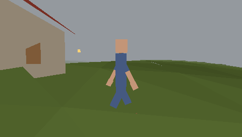
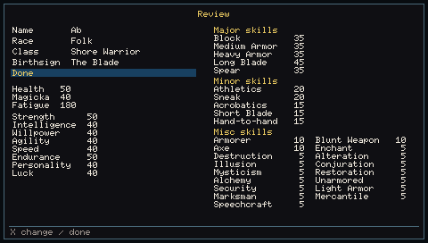
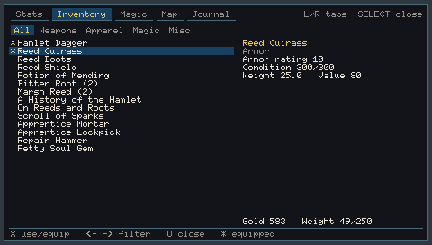

# Morrowind PSP Demake

A native Sony PSP-3000 runtime (C99 + Allegrex VFPU assembly, PSPSDK) plus an
offline PC "demake cooker" that converts **your own legally owned** copy of
*The Elder Scrolls III: Morrowind* (plus *Tribunal* / *Bloodmoon*) into
lightweight PS1/PSP-era assets: 16/256-colour swizzled textures, decimated
low-poly meshes with rigid-limb characters, and (in later milestones) zone
data, compiled MWScript bytecode and the full quest/dialogue database.

**No game data is included in this repository** and none is ever committed.
The cooker reads `Morrowind.esm` / `.bsa` files from your installation and
writes cooked packs to a local output directory.

Status and milestone plan: see [PROGRESS.md](PROGRESS.md).

## Layout

```
src/                     PSP runtime (C99)
  common.h               types, alignment helpers, asset-name hash
  fmt.h                  cooked binary formats (shared contract with the cooker)
  mem.c/.h               strict 32 MB static arena (regions, marks, pools, buddy)
  vfpu.c/.h              VFPU math: matrices, quaternions, culling, ray tests
  pak.c/.h               DPAK packs on the Memory Stick (directory + on-demand reads)
  texcache.c/.h          swizzled texture cache (buddy allocator, eviction, fallback)
  zone.c/.h              world index + validated zone/mesh/anim loader, terrain heights
  gfx.c/.h               sceGu renderer: fog, lights, culling, near-terrain tessellation
  anim.c/.h              fixed-rate animation clips (sampling, groups, looping)
  actor.c/.h             segmented rigid-limb NPCs/creatures: binding + posing
  phys.c/.h              collision grid, cylinder-vs-triangle movement, gravity, swimming
  game.c/.h              player controller, activation, doors, zone transitions, VM host (portable)
  inflate.c/.h           raw DEFLATE decoder for the text blocks
  rpgdb.c/.h             rpg.dpak: validated tables, text-block LRU cache, script paging
  vm.c/.h                MWScript bytecode VM + scripted state (journal, stats, inventories)
  mwfuncs.c/.h           generated MWScript verb ids/signatures (gen_mwfuncs.py)
  dialogue.c/.h          info filtering, greetings, topics, choices, hyperlinks, persuasion answers
  rpg.c/.h               character mechanics: stats, progression, magic effects, death, rest, chargen
  rpg_items.c            stacks, equipment, casting, combat, lock picking, item use
  rpg_trade.c            barter, services (training, spells, repair, travel), persuasion, crafting
  ai.c/.h                actor behaviour: AI packages, path grids + A*, combat, sneaking, crime, guards, spawns
  audio.c/.h             mixer: ADPCM effect cache, 3D voices, streamed music/speech, sceAudio + sceMp3 backend
  save.c/.h              saved games: CRC-checked slots written atomically, validated before loading
  ui.c/.h, ui_gu.c       8x8-font console UI core: dialogue + services, journal, books, message boxes
  ui_menu.c              SELECT menu tabs: Stats, Inventory, Magic, Map
  ui_trade.c             loot, barter, service, alchemy, repair, spellmaking, enchanting screens
  ui_char.c              character creation, level up, rest/wait, death, save/load slots, in-game HUD
  font8x8.h              MSX 8x8 font (PSPSDK)
  selftest.c/.h          allocator + VFPU-vs-scalar test suite (host and device)
  main.c                 boot (333 MHz), PSP input, pause menu, frame pacing, debug overlay, frame loop
tests/host/              native build of the portable runtime code + test runner
tools/demake_cooker/     Python 3 + Pillow offline cooker
  cook_all.py            runs the whole pipeline (meshes -> anims -> world -> rpg -> textures)
  rpg_compiler.py        ESM records -> rpg.dpak (dialogue, journal, scripts, items, spells...)
  mwscript.py            MWScript compiler -> bytecode (+ disassembler)
  mwsig.py               MWScript verb signatures; gen_mwfuncs.py writes src/mwfuncs.h
  mwdata.py              engine constants: 143 magic effects + flags, resistances, skills, markers
  sound_demaker.py       Sound/ + Music/ -> sounds.dpak (IMA ADPCM) + music.dpak (MP3 pass-through, playlists)
  tex_demaker.py         textures -> DTEX (T4/T8, swizzled) + icon atlases
  mesh_demaker.py        NIF -> DMESH (decimated, segmented skins, collision)
  anim_demaker.py        KF -> DANIM (text-key groups, 15 fps, root motion -> speed)
  actorpose.py           reference actor posing (preview + tests)
  world_demaker.py       ESM worldspace -> DZONE zones + DWORLD index
  esm.py                 TES3 ESM/ESP reader (load order merge) + writer
  nif.py                 NetImmerse 4.0.0.2 reader
  make_testworld.py      generates an original Morrowind-format test world
  preview_zone.py        software preview of a cooked zone (PNG)
  decimate.py            quadric edge-collapse decimation
  dmesh.py, dmcommon.py  writers/readers, BSA, DPAK, hashing
  dev/nifxml_dump.py     verifies NIF layouts against niftools nif.xml
docs/                    FORMATS.md, VFPU.md, NIF_LAYOUTS.md
```

## Building the PSP runtime

Install the pspdev toolchain (prebuilt release):

```bash
curl -L -o pspdev.tar.gz https://github.com/pspdev/pspdev/releases/latest/download/pspdev-ubuntu-latest-x86_64.tar.gz
```

```bash
mkdir -p "$HOME/pspdev-root" && tar -xzf pspdev.tar.gz -C "$HOME/pspdev-root"
```

```bash
export PSPDEV="$HOME/pspdev-root/pspdev" PATH="$HOME/pspdev-root/pspdev/bin:$PATH"
```

Then:

```bash
make
```

This produces `EBOOT.PBP`. Copy it to `ms0:/PSP/GAME/pspwind/EBOOT.PBP` on a
PSP-3000 running custom firmware (or open it in PPSSPP). The Milestone 1
harness runs the allocator and VFPU self-tests and reports
`ALL SELF-TESTS PASSED`.

## Tests

```bash
make test
```

`host-test` compiles the runtime's portable code natively (ASan + UBSan) and
runs the shared self-test suite; `tools-test` runs the cooker unit tests;
`world-test` cooks the synthetic test world, loads every zone through the
real C loader (plus validator fuzzing) and plays it through `game.c` with
scripted input (walking, collision, jumping, doors, swimming, zone borders,
NPC animation), runs the RPG layer on the cooked `rpg.dpak` (`rpg_test`:
quest via the dialogue engine + bytecode fuzzing; `mech_test`: character
creation, levelling, combat, magic, items, trade, services and crafting
numbers against Morrowind's formulas; `audio_test`: the mixer on the cooked
sounds; `ai_test`: path finding, wandering, packages, combat, sneaking,
crime, guards, jail and summons; `save_test`: save round trips and damaged
or fuzzed files) and plays the test quest plus every M5/M6 screen through
the UI with button presses (`ui_test`, screenshots in
`build/host/screens/`). None of them needs the PSP toolchain.

## Cooking assets

```bash
pip install -r tools/demake_cooker/requirements.txt
```

```bash
python3 tools/demake_cooker/cook_all.py --data "/path/to/Morrowind/Data Files" --out build/cooked
```

`--data` mounts a Data Files directory (its BSAs in Morrowind → Tribunal →
Bloodmoon order, loose files overriding archives; ESMs in the same order).
The pipeline cooks meshes, then animations, then zones (merging small statics
and assembling NPCs from race body parts using the cooked meshes and clips),
then the RPG database (`rpg_compiler.py`: dialogue, quests, books, factions,
items, spells, globals, GMSTs, AI packages, sound records, path grids, and
every script compiled to bytecode), then the sounds (`sound_demaker.py`:
effects to 4-bit ADPCM, music and voices kept as MP3 for the PSP's hardware
decoder), then
only the textures that meshes and zones reference (plus UI art, icons and
embedded NIF textures). Copy `meshes.dpak`, `anims.dpak`, `textures.dpak`,
`zones.dpak`, `rpg.dpak`, `sounds.dpak` and `music.dpak` to
`ms0:/PSP/GAME/pspwind/data/`. Saved games go to
`ms0:/PSP/GAME/pspwind/saves/`. Each step also runs on its own
(`mesh_demaker.py`, `world_demaker.py`, `tex_demaker.py`) with options such as
`--ratio` (triangle budget, default 0.5), `--zone-size` (cells per zone side,
default 3), `--merge-max-tris`, `--size`/`--small-size`, `--colors`,
`--dither`, `--jobs`, `--limit`, `--strict`. Every step writes a
`*_manifest.json` with statistics and failures.

Check a cooked zone on the PC without a PSP:

```bash
python3 tools/demake_cooker/preview_zone.py --data build/cooked --zone zone/ext_-1_-3 --out shot.png --eye -6000 -21000 600 --yaw 0 --pitch -10
```

## Try it without Morrowind

```bash
make package
```

Generates an original test world (`make_testworld.py`: hills, a shoreline, a
hamlet, a cellar behind a door, and a small quest — talk to the Hamlet
Weaver about her lost ring; the Hamlet Elder sells spells, trains, repairs,
makes spells, enchants and "travels" you to the cellar, the Weaver barters,
a crate and a critter can be looted), cooks it, and puts `EBOOT.PBP` plus the
cooked data in `build/psp/pspwind/` — copy that folder to `ms0:/PSP/GAME/`
or load the EBOOT in PPSSPP. A new game starts with character creation
(name, race and sex, class, birthsign, review).




Controls (scheme A; START → pause menu switches to scheme B, where the stick
looks and the face buttons walk):

| Input | Action |
|---|---|
| analog stick | walk / strafe |
| △ / ✕ | look up / down |
| □ / ○ | turn left / right |
| R | activate (doors, NPCs, containers, corpses, items); with a weapon ready hold to wind up and release to strike (bows shoot, a readied lockpick picks the targeted lock); with magic ready cast |
| L | jump |
| D-pad ↑ / ↓ | run–walk toggle / sneak |
| D-pad ← | ready / sheathe the weapon |
| D-pad → | ready / put away the selected spell, power or enchanted item |
| SELECT | menu: L/R switch Stats, Inventory, Magic, Map, Journal |
| START | pause menu: save game, load game, controls A/B, invert look, music / effects volume, frame rate (auto 60→30, 60, 30), face culling, debug overlay (with frame timings), fly mode (debug), next animation (debug), quit |

Menu tabs: **Stats** (attributes, health/magicka/fatigue, level progress,
skills by major/minor/misc with progress, factions; △ rest/wait),
**Inventory** (←/→ filter All/Weapons/Apparel/Magic/Misc, ✕ equip, drink,
eat, read, use a mortar for alchemy, a hammer to repair, a filled soul gem to
enchant), **Magic** (powers, spells with cost/chance, enchanted items with
charge; ✕ selects what D-pad → readies; active effects), **Map** (explored
exterior cells, your position; D-pad pans, △ recentres), **Journal** (△
pages: entries, quests, topics; ✕ open, ○ back).

In dialogue: the service entries (Persuasion, Barter, Spells, Training,
Repair, Travel, Spellmaking, Enchanting — whichever the NPC offers) come
first, then the topics; ↑/↓ choose, ✕ ask, → jump into the hyperlinks of the
text (↑/↓ between links, ✕ ask, ← back), L/R scroll, ○ goodbye. Barter and
loot: ←/→ switch side, ✕ trade one / move a stack, □ trade a stack, △ take
all. Effect editor (spellmaking, enchanting): ↑/↓ field, ←/→ change (L/R by
ten), ✕ remove, ○ done. On-screen keyboard: D-pad, ✕ type, □ delete, START
done. Books: ↑/↓ scroll, □ take, ✕ close. Message boxes: ←/→ and ✕.

Saves: eight slots (0 is the quicksave) with name, level, place, game date
and play time; ✕ saves (twice to overwrite) or loads, ○ back. After death,
✕ loads the newest save, △ picks one, □ starts again where you are.




Walking off an exterior zone loads the neighbouring zone behind a loading
card; activating a door with a destination loads the target cell.
