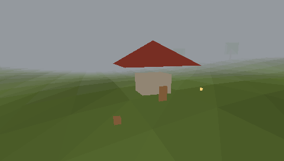

# Morrowind PSP Demake

A native Sony PSP-3000 runtime (C99 + Allegrex VFPU assembly, PSPSDK) plus an
offline PC "demake cooker" that converts **your own legally owned** copy of
*The Elder Scrolls III: Morrowind* (plus *Tribunal* / *Bloodmoon*) into
lightweight PS1/PSP-era assets: 16/256-colour swizzled textures, decimated
low-poly meshes with rigid-limb characters, and (in later milestones) zone
data, compiled MWScript bytecode and the full quest/dialogue database.

**No game data is included in this repository** and none is ever committed.
The cooker reads `Morrowind.esm` / `.bsa` files from your installation and
writes cooked packs to a local output directory.

Status and milestone plan: see [PROGRESS.md](PROGRESS.md).

## Layout

```
src/                     PSP runtime (C99)
  common.h               types, alignment helpers, asset-name hash
  fmt.h                  cooked binary formats (shared contract with the cooker)
  mem.c/.h               strict 32 MB static arena (regions, marks, pools, buddy)
  vfpu.c/.h              VFPU math: matrices, quaternions, culling, ray tests
  pak.c/.h               DPAK packs on the Memory Stick (directory + on-demand reads)
  texcache.c/.h          swizzled texture cache (buddy allocator, eviction, fallback)
  zone.c/.h              world index + validated zone/mesh loader, terrain heights
  gfx.c/.h               sceGu renderer: fog, lights, culling, near-terrain tessellation
  selftest.c/.h          allocator + VFPU-vs-scalar test suite (host and device)
  main.c                 boot self-test + zone viewer
tests/host/              native build of the portable runtime code + test runner
tools/demake_cooker/     Python 3 + Pillow offline cooker
  cook_all.py            runs the whole pipeline (meshes -> world -> textures)
  tex_demaker.py         textures -> DTEX (T4/T8, swizzled) + icon atlases
  mesh_demaker.py        NIF -> DMESH (decimated, segmented skins, collision)
  world_demaker.py       ESM worldspace -> DZONE zones + DWORLD index
  esm.py                 TES3 ESM/ESP reader (load order merge) + writer
  nif.py                 NetImmerse 4.0.0.2 reader
  make_testworld.py      generates an original Morrowind-format test world
  preview_zone.py        software preview of a cooked zone (PNG)
  decimate.py            quadric edge-collapse decimation
  dmesh.py, dmcommon.py  writers/readers, BSA, DPAK, hashing
  dev/nifxml_dump.py     verifies NIF layouts against niftools nif.xml
docs/                    FORMATS.md, VFPU.md, NIF_LAYOUTS.md
```

## Building the PSP runtime

Install the pspdev toolchain (prebuilt release):

```bash
curl -L -o pspdev.tar.gz https://github.com/pspdev/pspdev/releases/latest/download/pspdev-ubuntu-latest-x86_64.tar.gz
```

```bash
mkdir -p "$HOME/pspdev-root" && tar -xzf pspdev.tar.gz -C "$HOME/pspdev-root"
```

```bash
export PSPDEV="$HOME/pspdev-root/pspdev" PATH="$HOME/pspdev-root/pspdev/bin:$PATH"
```

Then:

```bash
make
```

This produces `EBOOT.PBP`. Copy it to `ms0:/PSP/GAME/pspwind/EBOOT.PBP` on a
PSP-3000 running custom firmware (or open it in PPSSPP). The Milestone 1
harness runs the allocator and VFPU self-tests and reports
`ALL SELF-TESTS PASSED`.

## Tests

```bash
make test
```

`host-test` compiles the runtime's portable code natively (ASan + UBSan) and
runs the shared self-test suite; `tools-test` runs the cooker unit tests;
`world-test` cooks the synthetic test world and loads every zone through the
real C loader (plus validator fuzzing). None of them needs the PSP toolchain.

## Cooking assets

```bash
pip install -r tools/demake_cooker/requirements.txt
```

```bash
python3 tools/demake_cooker/cook_all.py --data "/path/to/Morrowind/Data Files" --out build/cooked
```

`--data` mounts a Data Files directory (its BSAs in Morrowind → Tribunal →
Bloodmoon order, loose files overriding archives; ESMs in the same order).
The pipeline cooks meshes, then zones (merging small statics using the cooked
meshes), then only the textures that meshes and zones reference (plus UI art,
icons and embedded NIF textures). Copy `meshes.dpak`, `textures.dpak` and
`zones.dpak` to `ms0:/PSP/GAME/pspwind/data/`. Each step also runs on its own
(`mesh_demaker.py`, `world_demaker.py`, `tex_demaker.py`) with options such as
`--ratio` (triangle budget, default 0.5), `--zone-size` (cells per zone side,
default 3), `--merge-max-tris`, `--size`/`--small-size`, `--colors`,
`--dither`, `--jobs`, `--limit`, `--strict`. Every step writes a
`*_manifest.json` with statistics and failures.

Check a cooked zone on the PC without a PSP:

```bash
python3 tools/demake_cooker/preview_zone.py --data build/cooked --zone zone/ext_-1_-3 --out shot.png --eye -6000 -21000 600 --yaw 0 --pitch -10
```

## Try it without Morrowind

```bash
make package
```

Generates an original test world (`make_testworld.py`: hills, a shoreline, a
hamlet, a cellar behind a door), cooks it, and puts `EBOOT.PBP` plus the
cooked data in `build/psp/pspwind/` — copy that folder to `ms0:/PSP/GAME/`
or load the EBOOT in PPSSPP.



Viewer controls: analog = move, D-pad = turn/look, R/L = up/down,
X = go through a door, △/□ = next/previous zone, ○ = overlay,
SELECT = cycle face culling (CW/CCW/off), START = quit. Walking off an
exterior zone loads the neighbouring zone behind a loading card.
